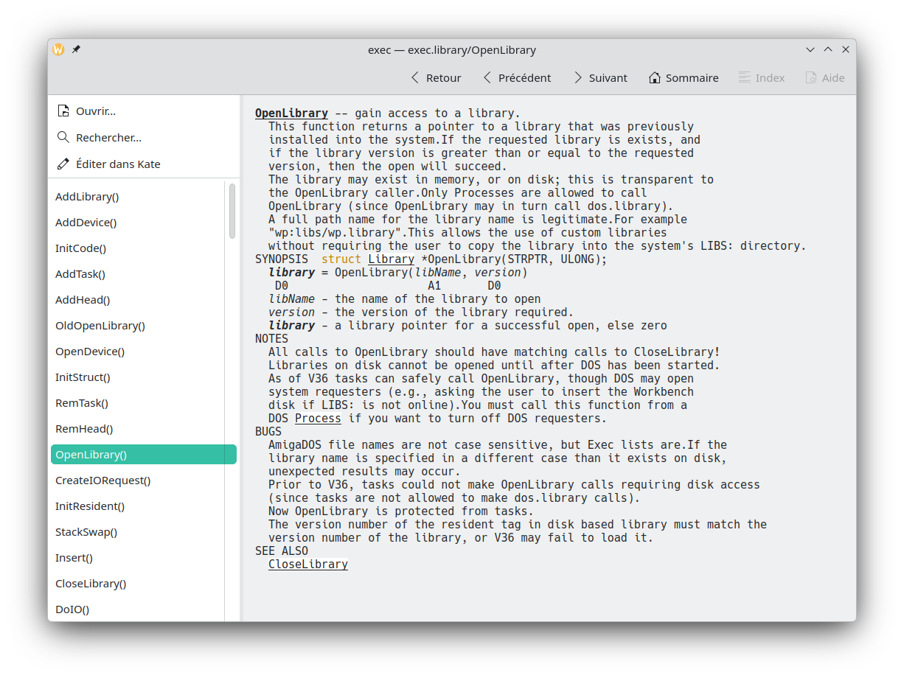

# AmigaGuide Viewer

Visionneuse de documents **AmigaGuide** (`.guide`) pour **KDE Plasma**, écrite en C++ avec Qt 6 et l'interface Kirigami.
Pour Ubuntu, Linux Mint et autres distributions sans KDE, il y a une release, (voir installation ci-dessous).



> Projet indépendant : il n'est affilié ni à Hyperion Entertainment ni aux détenteurs des marques Amiga.

## Fonctions

- Navigation par liens, y compris vers d'autres fichiers `.guide`, avec historique (Retour)
- Sommaire dans un volet latéral redimensionnable (liens du nœud `MAIN`)
- Boutons Précédent, Suivant, Sommaire, Index et Aide (`@next`, `@prev`, `@toc`, `@index`, `@help`)
- **Images intégrées** d'AmigaOS 3.2 : `@{img "fichier"}` et `@{"fichier" img}`
- Recherche plein texte dans tous les nœuds du guide
- **Édition dans Kate** : s'ouvre directement sur la section affichée, et le guide se recharge à l'enregistrement
- Styles : gras, italique, souligné, couleurs nommées, alignement, indentation, tabulations
- Fichiers ISO-8859-1 (encodage d'origine de l'Amiga) et UTF-8, chemins insensibles à la casse

## Raccourcis

| Raccourci | Action |
|---|---|
| Ctrl+O | Ouvrir un guide |
| Ctrl+F | Rechercher |
| Ctrl+E | Éditer dans Kate |
| Alt+Gauche | Retour |
| Alt+Début | Sommaire |
| F1 | Aide du guide |

## Installation

Dépendances de compilation : CMake, un compilateur C++17, Qt ≥ 6.4 (Core, Gui, Qml, Quick, Widgets).
À l'exécution : Kirigami 6 et `qqc2-desktop-style`. En option : `kimageformats` (images IFF) et `kate`.

Sur Arch / Manjaro :

```bash
sudo pacman -S --needed base-devel cmake qt6-base qt6-declarative kirigami qqc2-desktop-style
git clone https://github.com//GuillaumeFromBordeaux/amigaguide-viewer.git
cd amigaguide-viewer
cmake -B build -DCMAKE_BUILD_TYPE=Release
cmake --build build -j$(nproc)
./build/amigaguide-viewer sample.guide
```

Pour l'installer sur le système (menu d'applications et ouverture des `.guide` depuis Dolphin) :

```bash
sudo cmake --install build
```

Un modèle de `PKGBUILD` se trouve dans `packaging/arch/`.

Développé et testé sous Manjaro KDE (Qt 6.11, Kirigami 6.30).

## Ubuntu, Linux Mint et autres distributions sans KDE

Ubuntu 24.04 et Linux Mint 22 n'ont pas Kirigami 6 dans leurs dépôts. Le projet propose donc une **seconde interface, sans Kirigami**, qui n'utilise que Qt Quick Controls : même fonctionnement, même disposition, aucun paquet KDE à installer. On la choisit à la compilation avec `-DUSE_KIRIGAMI=OFF`.

Le paquet `.deb` fourni dans les *Releases* est construit ainsi. Pour l'installer :

```bash
sudo apt install ./amigaguide-viewer_1.0.0_amd64.deb
```

Pour le compiler vous-même (testé sous Ubuntu 24.04, base de Linux Mint 22) :

```bash
sudo apt install build-essential cmake qt6-base-dev qt6-declarative-dev libgl1-mesa-dev \
  qml6-module-qtquick qml6-module-qtqml-workerscript qml6-module-qtquick-window \
  qml6-module-qtquick-controls qml6-module-qtquick-templates qml6-module-qtquick-layouts \
  qml6-module-qtquick-dialogs qml6-module-qt-labs-folderlistmodel
cmake -B build -DCMAKE_BUILD_TYPE=Release -DUSE_KIRIGAMI=OFF
cmake --build build -j$(nproc)
./build/amigaguide-viewer sample.guide
```

Pour fabriquer le paquet `.deb` : `cd build && cpack -G DEB`.

Facultatif : `kate` (bouton « Éditer dans Kate ») et `qt6-translations-l10n` (boîtes de dialogue Qt dans votre langue).

## Images

PNG, JPEG, GIF et BMP sont lus directement. Pour les images IFF (le format Amiga d'origine), installez le plugin `kimageformats` (`sudo pacman -S kimageformats`).
Si une image est introuvable ou illisible, `[image : nom]` s'affiche à sa place.

## Limites connues

- Les commandes `system`, `rx`, `rxs`, `quit` et `close` ne sont pas exécutées (un message s'affiche)
- `@font`, `@macro`, `@{code}` et `@{settabs}` sont ignorés
- Le saut à un numéro de ligne dans un lien est ignoré
- Seules les couleurs nommées (`shine`, `shadow`, `fill`, `filltext`, `highlight`) sont gérées, pas les numéros de pen

## Contribuer

Les guides qui s'affichent mal sont la meilleure source de corrections : ouvrez une *issue* en joignant le fichier (s'il est redistribuable) ou un extrait.

## Licence

Copyright (C) 2026 AmigaGuide Viewer contributors.
Distribué sous licence **GNU GPL version 3 ou ultérieure** (voir `LICENSE`).
